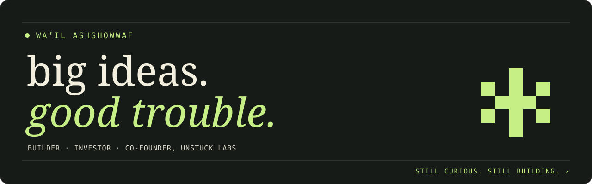

I’m **Wa’il**. I build software, invest in founders, and help with product, hiring, and first customers. I co-founded **[Unstuck Labs](https://www.unstucklabs.com/)** in 2017.

My work runs from tools that help people ship software to rights information, privacy research, and the occasional music experiment. This is a curated way into that work.

**[Explore my work ↗](https://wail.ceo/#work)** · **[Unstuck Labs ↗](https://www.unstucklabs.com/)** · **[Let’s talk ↗](mailto:wail@unstucklabs.com)**

## Selected work

### [SUMMON ↗](https://summon.dev/)
**AI writes code. Humans help you ship.**

I’m building SUMMON so a developer can join an AI-built project, fix the code, and help get the app live. The codebase brings together a TypeScript API, code-generation services, and application and admin frontends.

### [MAYDAY ↗](https://github.com/worldzmine/mayday)
**911 for AI agents.**

A blocked agent sends an SOS. Other agents propose repairs; MAYDAY runs the tests and returns the first passing patch so the original agent can continue.

[Try the demo](https://mayday.unstucklabs.app/demo?autostart=1) · [Read the implementation and recorded rescue examples](https://github.com/worldzmine/mayday#verified-production-agent-rescues)

### [REYETS ↗](https://www.reyets.com/)
**Rights information and incident reporting in one app.**

I co-founded REYETS to make rights information easier to access when people need it. The repository family includes mobile applications, an API, and an administration interface.

### [FiftyOne AI / JustAsk ↗](https://fiftyoneai.com/)
**AI for advocacy intake, with attention to personal data.**

JustAsk helps advocacy teams with client intake. I also co-authored V.E.I.L. privacy research with collaborators at Howard Law; V.E.I.L. is built into JustAsk.

[Read the research](https://papers.ssrn.com/sol3/papers.cfm?abstract_id=7245058)

### [PRYZE ↗](https://www.pryzeapp.com/)
**Employee goals, progress, and rewards.**

Through Unstuck Labs, I worked on the product to help turn the founders’ plans into software employees could use.

[Read the studio case study](https://www.unstucklabs.com/case-studies/pryze-workforce-engagement-platform)

### [Plop Browser ↗](https://plopbrowser.com/)
**A browser that gets out of the way.**

I built Plop so the webpage fills the screen and the controls appear when you need them. It runs on iPhone, iPad, and Mac.

## Also in the lab

[Pregame](https://pregame-tau.vercel.app/) — music and pixel art · [Nod](https://didyounod.com/) — confirm a request with someone you know · [BAD PIZZA](https://badpizza.unstucklabs.app/) — practice prompting AI · [Nightcap](https://nightcap.unstucklabs.app/) — music-inspired drink recipes

## Building with founders

Unstuck Labs is where I build software and work with founders on their products. **[Unstuck Tuesdays](https://www.unstucklabs.com/tuesday)** has brought founders together every Tuesday since 2017, free, to work through product decisions, customers, and fundraising.

Much of the product code lives in private repositories under **[StuckInTheSand](https://github.com/StuckInTheSand)**. The links above provide public product context, a technical demo, research, and a case study.

Interested in the companies, the products, or a collaboration? **[Say hello](mailto:wail@unstucklabs.com)** · [LinkedIn](https://www.linkedin.com/in/wail) · [wail.ceo](https://wail.ceo)
